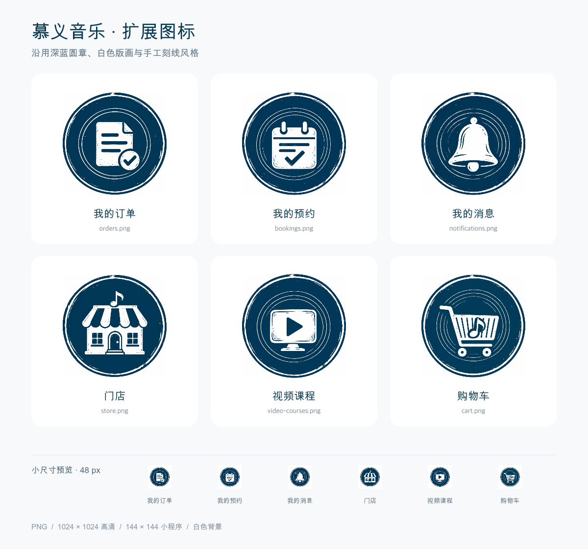

# 扩展图标生成说明

生成日期：2026-10-19。

使用内置 imagegen，以项目现有 PNG 图标为参照生成 6 枚扩展图标。保留深蓝圆章、白色主体、同心细线和轻微版画磨损纹理；未替换已有图标或修改页面引用。

## 预览



## 素材

每枚图标提供白色不透明背景的 PNG：`高清图标/` 为 1024×1024，`小程序图标/` 为 144×144。均已统一居中和外侧留白，保留原始生成纹理。

| 用途     | 文件名              | 高清版                                    | 小程序版                                  |
| -------- | ------------------- | ----------------------------------------- | ----------------------------------------- |
| 我的订单 | `orders.png`        | [1024×1024](./高清图标/orders.png)        | [144×144](./小程序图标/orders.png)        |
| 我的预约 | `bookings.png`      | [1024×1024](./高清图标/bookings.png)      | [144×144](./小程序图标/bookings.png)      |
| 我的消息 | `notifications.png` | [1024×1024](./高清图标/notifications.png) | [144×144](./小程序图标/notifications.png) |
| 门店     | `store.png`         | [1024×1024](./高清图标/store.png)         | [144×144](./小程序图标/store.png)         |
| 视频课程 | `video-courses.png` | [1024×1024](./高清图标/video-courses.png) | [144×144](./小程序图标/video-courses.png) |
| 购物车   | `cart.png`          | [1024×1024](./高清图标/cart.png)          | [144×144](./小程序图标/cart.png)          |

## 风格依据与检查

- 直接参考 `apps/miniapp/src/assets/icons/muyi/course-note.png`，并对照首页鹿头、麦克风和课表图标。
- 颜色沿用现有深蓝、白色，主体通过白色剪影和深蓝刻线表达。
- 已检查六种主体、无文字水印、圆章完整性、居中留白及 48 px 总览中的可辨识度。
- 圆圈数量和手工磨损保留生成差异，属于同风格扩展设计。
- 本次交付为设计素材，接入应用时可按现有图标目录及映射方式使用。

## 最终生成提示词

六次生成均使用 `course-note.png` 作为编辑参考，`transparent_background: false`。以下为实际发送的完整提示词。

### 我的订单

```text
Use case: style-transfer. Asset type: MuYiMusic music-school app raster UI icon.
Edit the attached existing icon non-destructively into a NEW sibling icon: keep the original badge's design language, and replace ONLY the central pictogram as specified below.
Invariants: a centered solid very dark navy-blue circular seal, approximately #00374f, on an opaque clean near-white square canvas; two narrow hand-drawn white concentric border rings plus a very thin navy outer outline; a restrained distressed linocut/engraved print texture, with a few tiny pale flecks. High-contrast white silhouette and delicate navy engraved cut-lines within the subject. Flat 2D, no gradients, no shadow, no 3D, no glow. The navy disc occupies around 82% of the square width; even outer padding. The single white central subject occupies around 50-58% of the square width and remains readable at 144 pixels. Match reference line weight and handmade vintage music badge mood closely. Keep all elements within the badge. No letters, words, numerals, caption, watermark or extra panels. Deliver one square icon per image, preferably 1024x1024.
Replacement central pictogram: A white vintage paper receipt / order sheet with a folded upper-right corner, three broad horizontal navy cut-line rows, and a small round confirmation check seal at its lower-right. Compact, clear, iconic; the object is distinct from a musical score, no music notes.
```

### 我的预约

```text
Use case: style-transfer. Asset type: MuYiMusic music-school app raster UI icon.
Edit the attached existing icon non-destructively into a NEW sibling icon: keep the original badge's design language, and replace ONLY the central pictogram as specified below.
Invariants: a centered solid very dark navy-blue circular seal, approximately #00374f, on an opaque clean near-white square canvas; two narrow hand-drawn white concentric border rings plus a very thin navy outer outline; a restrained distressed linocut/engraved print texture, with a few tiny pale flecks. High-contrast white silhouette and delicate navy engraved cut-lines within the subject. Flat 2D, no gradients, no shadow, no 3D, no glow. The navy disc occupies around 82% of the square width; even outer padding. The single white central subject occupies around 50-58% of the square width and remains readable at 144 pixels. Match reference line weight and handmade vintage music badge mood closely. Keep all elements within the badge. No letters, words, numerals, caption, watermark or extra panels. Deliver one square icon per image, preferably 1024x1024.
Replacement central pictogram: A white small appointment desk-calendar with two top binding loops, two short navy horizontal rows inside it and one prominent navy check mark on its lower half. Subtle handmade engraved strokes; no numbers or text, no music notes.
```

### 我的消息

```text
Use case: style-transfer. Asset type: MuYiMusic music-school app raster UI icon.
Edit the attached existing icon non-destructively into a NEW sibling icon: keep the original badge's design language, and replace ONLY the central pictogram as specified below.
Invariants: a centered solid very dark navy-blue circular seal, approximately #00374f, on an opaque clean near-white square canvas; two narrow hand-drawn white concentric border rings plus a very thin navy outer outline; a restrained distressed linocut/engraved print texture, with a few tiny pale flecks. High-contrast white silhouette and delicate navy engraved cut-lines within the subject. Flat 2D, no gradients, no shadow, no 3D, no glow. The navy disc occupies around 82% of the square width; even outer padding. The single white central subject occupies around 50-58% of the square width and remains readable at 144 pixels. Match reference line weight and handmade vintage music badge mood closely. Keep all elements within the badge. No letters, words, numerals, caption, watermark or extra panels. Deliver one square icon per image, preferably 1024x1024.
Replacement central pictogram: A single white classic notification bell, elegant rounded dome, small top knob, broad lower rim and one simple white clapper below. The bell is centered, large, balanced and instantly legible. Use only a few fine navy engraving lines on the bell body.
```

### 门店

```text
Use case: style-transfer. Asset type: MuYiMusic music-school app raster UI icon.
Edit the attached existing icon non-destructively into a NEW sibling icon: keep the original badge's design language, and replace ONLY the central pictogram as specified below.
Invariants: a centered solid very dark navy-blue circular seal, approximately #00374f, on an opaque clean near-white square canvas; two narrow hand-drawn white concentric border rings plus a very thin navy outer outline; a restrained distressed linocut/engraved print texture, with a few tiny pale flecks. High-contrast white silhouette and delicate navy engraved cut-lines within the subject. Flat 2D, no gradients, no shadow, no 3D, no glow. The navy disc occupies around 82% of the square width; even outer padding. The single white central subject occupies around 50-58% of the square width and remains readable at 144 pixels. Match reference line weight and handmade vintage music badge mood closely. Keep all elements within the badge. No letters, words, numerals, caption, watermark or extra panels. Deliver one square icon per image, preferably 1024x1024.
Replacement central pictogram: A charming white front-facing music-school storefront: compact building, three-panel striped awning, simple centered doorway, one small navy window cutout on each side, and one tiny white music note above the awning as part of the building's silhouette. Keep the facade simple and icon-like, no sign lettering.
```

### 视频课程

```text
Use case: style-transfer. Asset type: MuYiMusic music-school app raster UI icon.
Edit the attached existing icon non-destructively into a NEW sibling icon: keep the original badge's design language, and replace ONLY the central pictogram as specified below.
Invariants: a centered solid very dark navy-blue circular seal, approximately #00374f, on an opaque clean near-white square canvas; two narrow hand-drawn white concentric border rings plus a very thin navy outer outline; a restrained distressed linocut/engraved print texture, with a few tiny pale flecks. High-contrast white silhouette and delicate navy engraved cut-lines within the subject. Flat 2D, no gradients, no shadow, no 3D, no glow. The navy disc occupies around 82% of the square width; even outer padding. The single white central subject occupies around 50-58% of the square width and remains readable at 144 pixels. Match reference line weight and handmade vintage music badge mood closely. Keep all elements within the badge. No letters, words, numerals, caption, watermark or extra panels. Deliver one square icon per image, preferably 1024x1024.
Replacement central pictogram: A white compact vintage video lesson screen: a softly rectangular frame with a large centered triangular play-button navy cutout; beneath the frame a short white pedestal. Subtle engraved edge marks only. Clear silhouette, no text, no music notes.
```

### 购物车

```text
Use case: style-transfer. Asset type: MuYiMusic music-school app raster UI icon.
Edit the attached existing icon non-destructively into a NEW sibling icon: keep the original badge's design language, and replace ONLY the central pictogram as specified below.
Invariants: a centered solid very dark navy-blue circular seal, approximately #00374f, on an opaque clean near-white square canvas; two narrow hand-drawn white concentric border rings plus a very thin navy outer outline; a restrained distressed linocut/engraved print texture, with a few tiny pale flecks. High-contrast white silhouette and delicate navy engraved cut-lines within the subject. Flat 2D, no gradients, no shadow, no 3D, no glow. The navy disc occupies around 82% of the square width; even outer padding. The single white central subject occupies around 50-58% of the square width and remains readable at 144 pixels. Match reference line weight and handmade vintage music badge mood closely. Keep all elements within the badge. No letters, words, numerals, caption, watermark or extra panels. Deliver one square icon per image, preferably 1024x1024.
Replacement central pictogram: One white traditional shopping cart viewed from the side, basket with a few simple navy engraved slats, one clear angled handle at upper-left, and two small white round wheels. A small white musical eighth note sits in the basket. Clear uncluttered silhouette, avoid extra objects.
```
